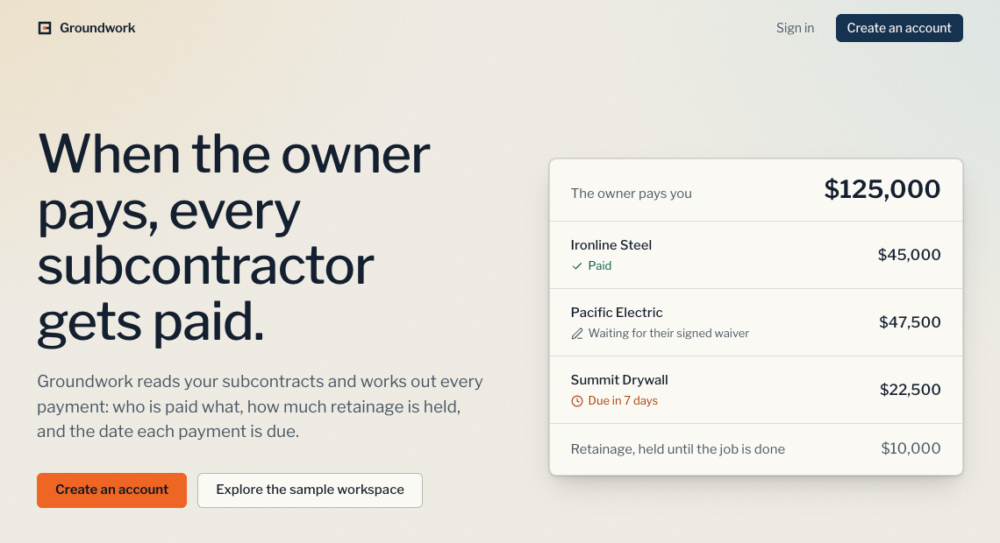
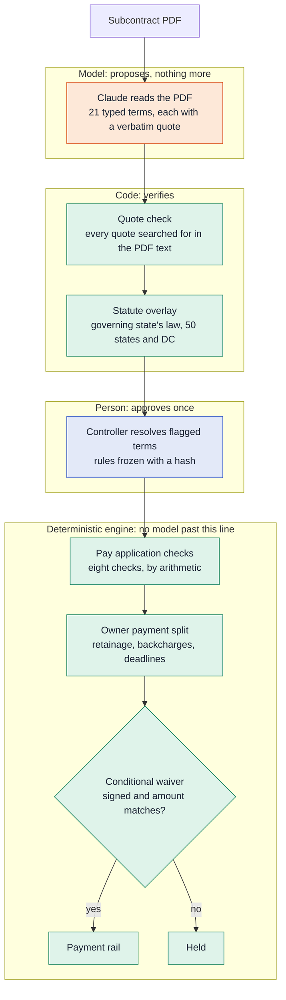
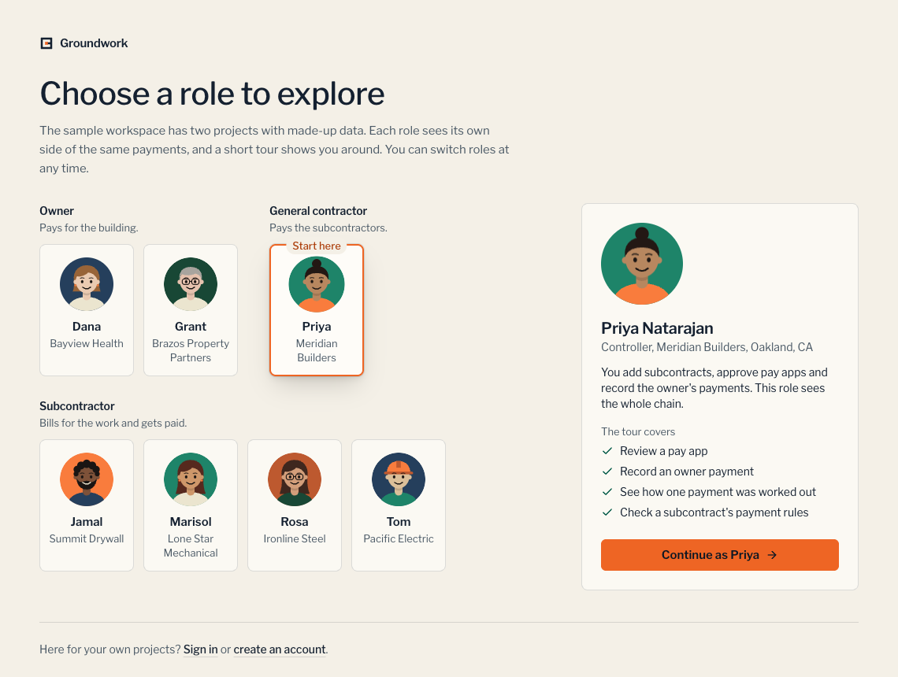
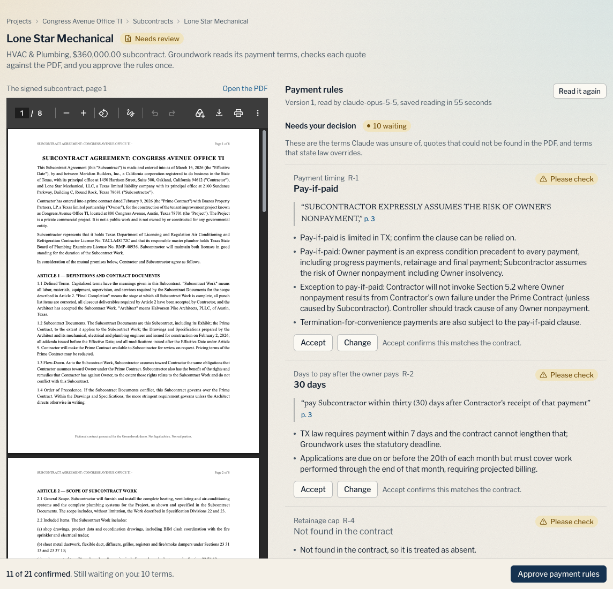
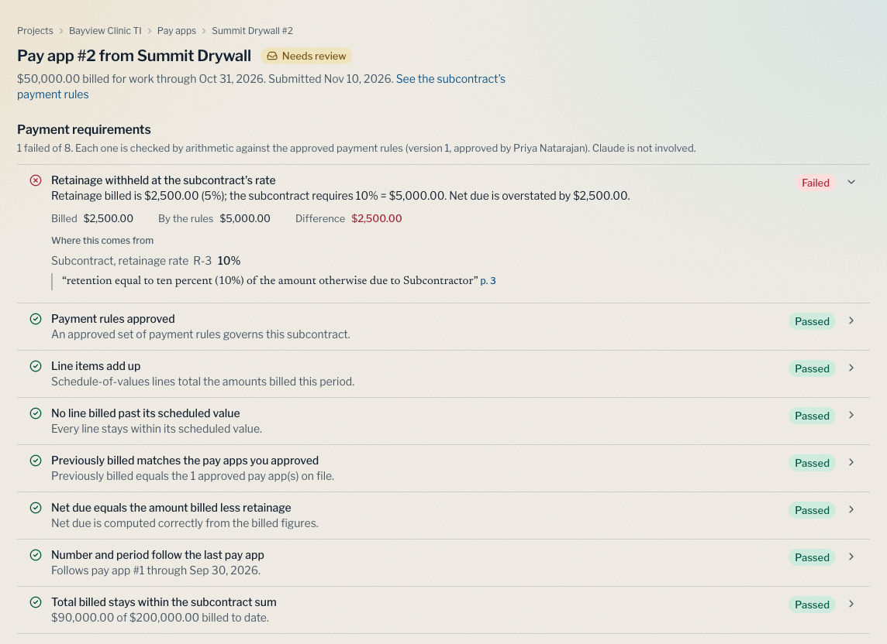
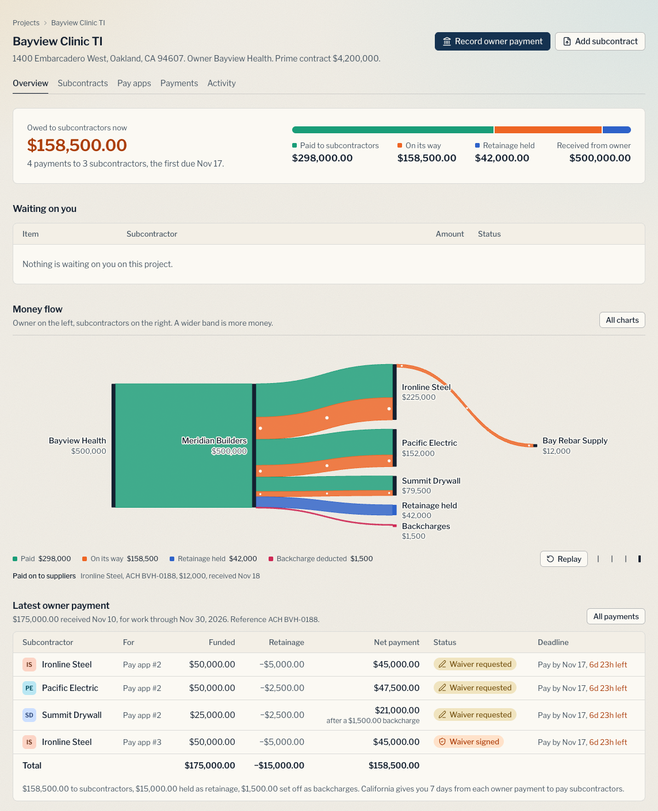
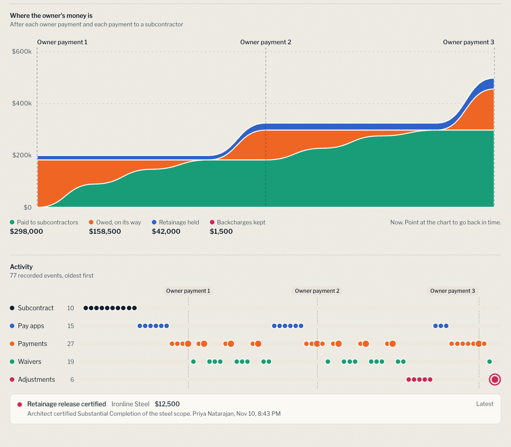
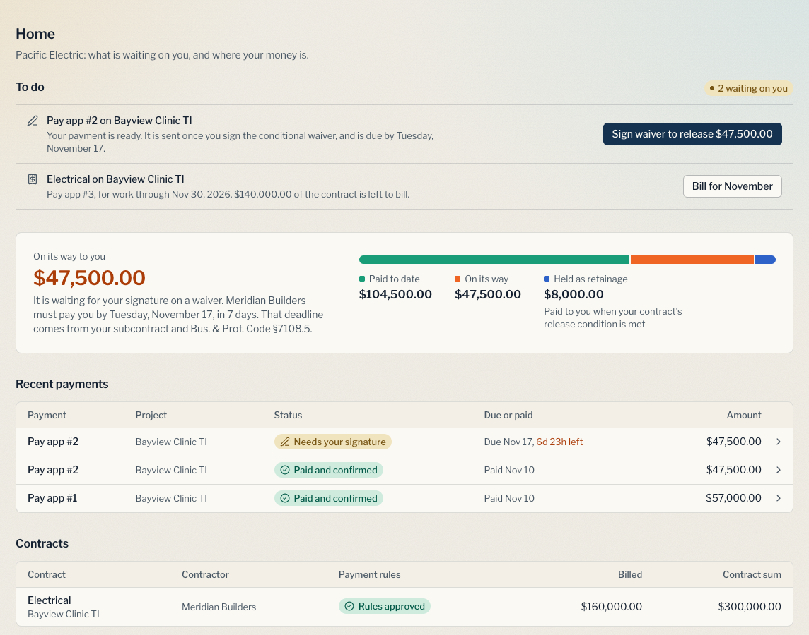
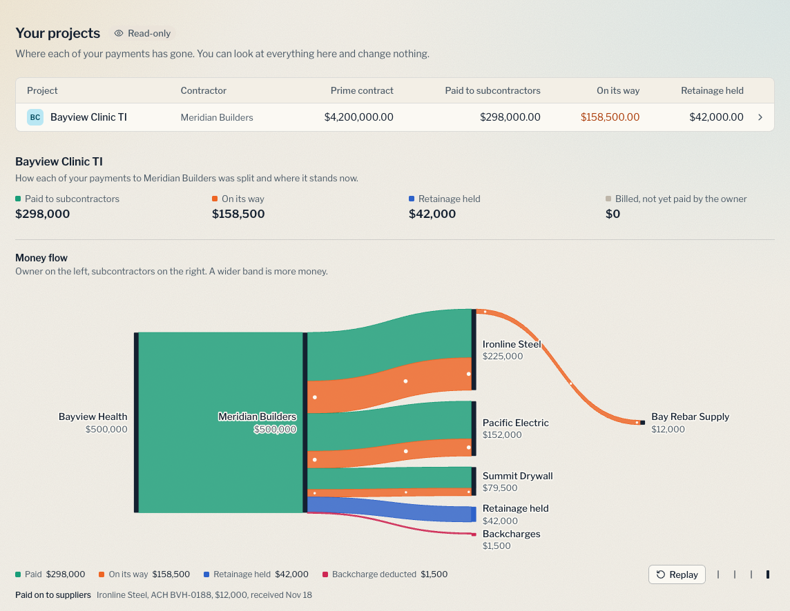
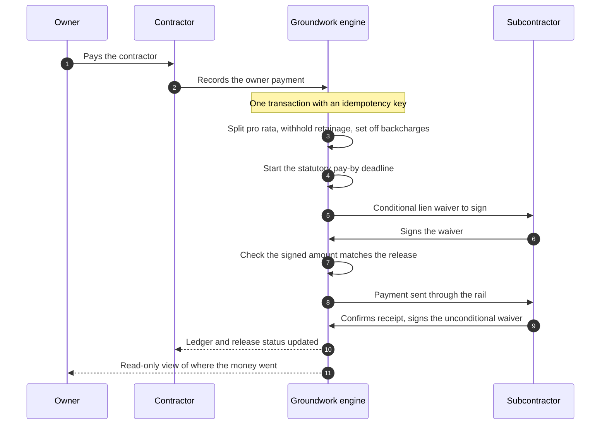

# Groundwork

[](https://github.com/73anthonyL/groundwork/actions/workflows/ci.yml)

**The owner pays the contractor in 17 days. The subcontractor who did the work waits 50.**
**The contract already says when the sub gets paid. Groundwork makes the money obey it.**
**AI reads the contract. Code pays.**

<p align="center">
  
</p>

Groundwork reads each construction subcontract once with Claude, which proposes typed payment rules with the exact clause quoted beside every value. Code checks every quote against the PDF and applies the governing state's payment law. A person approves the rules once. After that no model is involved: deterministic code checks each pay application by arithmetic and, when the owner pays, splits the money between subcontractors, holds retainage, requests lien waivers, starts the statutory deadlines, and sends each payment once its waiver is signed.

Built for the BBS × Ramp hackathon ("Automate the Old Way"), technical track. It is a working prototype: it is not deployed, it runs on sample data, and no real money moves.

## Contents

- [The problem](#the-problem)
- [The idea: AI reads, code pays](#the-idea-ai-reads-code-pays)
- [What it does](#what-it-does)
- [How it works](#how-it-works)
- [Every state](#every-state)
- [Evaluation](#evaluation)
- [Run it](#run-it)
- [Repository map](#repository-map)
- [Engineering docs](#engineering-docs)
- [Limits and honest notes](#limits-and-honest-notes)

## The problem

In US commercial construction the owner pays the general contractor, the contractor pays the subcontractors, and the subcontractors pay their suppliers. The owner's money reaches the contractor in a median of **17 days**. The subcontractor waits a median of **50** (Built payment ledger, August 2026).

The 33 days in between are not a dispute about what is owed. The subcontract already fixes the timing, the retainage and the paperwork. The delay is the work of applying it by hand, every month, for every subcontractor:

- re-reading the subcontract to find the payment terms
- working out retainage in a spreadsheet
- chasing a lien waiver by email
- issuing each payment by hand

Tools that move money make someone configure the rules by hand and click "pay". Tools that read contracts stop at a risk flag. Groundwork connects the two: subcontract to typed rule to automatic execution when the owner pays.

## The idea: AI reads, code pays

A wrong sentence is cheap to catch. A wrong payment is not. So the model works only where a mistake is cheap: it reads the contract and proposes. It never does arithmetic, never decides whether a clause is enforceable, and never moves money.



Three properties follow from that boundary:

- **Checkable.** Every extracted value carries a quote, and a program looks for that quote in the PDF. A value whose quote is not found, whose confidence is low, or which conflicts with statute goes to a person.
- **Repeatable.** The payment planner is a pure function over integer cents. The same inputs always produce the same payments, and a replay test re-derives every stored release from scratch.
- **Independent of the model at run time.** If the model is unavailable, reading new contracts pauses. Paying on approved rules does not.

## What it does

Three roles see the same payments from their own side. The sample workspace at `/sample` lets you sign in as any of them.

<p align="center">
  
</p>

### The contractor's controller

**1. Read the subcontract, approve the rules once.** The PDF sits beside the terms Claude proposed. Each term shows the quoted clause and its page. Flagged terms need a decision; here a Texas subcontract says 30 days, Texas law requires 7 and the contract cannot lengthen it, so the engine will use the statutory deadline.

<p align="center">
  
</p>

**2. Check each pay application by arithmetic.** Eight checks run against the approved rules. This subcontractor billed retainage at 5% where its contract says 10%; the check fails, shows the $2,500 difference, and cites the clause. The model is not involved.

<p align="center">
  
</p>

**3. Record the owner's payment; the engine does the rest.** One action splits the payment between subcontractors, withholds retainage, sets off backcharges, drafts the waivers and starts each deadline.

<p align="center">
  
</p>

Every chart is drawn from the append-only ledger. The balance chart shows where the owner's money stood after each event; the activity tracks show every recorded event in order.

<p align="center">
  
</p>

### The subcontractor and the owner

<table>
  <tr>
    <td width="50%" valign="top">
      
    </td>
    <td width="50%" valign="top">
      
    </td>
  </tr>
  <tr>
    <td valign="top"><b>Subcontractor.</b> Bills for the period, signs the waiver that releases the payment, and sees how much is coming, by what date, and which clause and statute set that date.</td>
    <td valign="top"><b>Owner.</b> Read-only. Sees how far each of their payments has travelled down the chain.</td>
  </tr>
</table>

A subcontractor's own suppliers and sub-subcontractors need no account. They open a link (`/w/:token`), read the waiver, and sign.

Screenshots are of the running app on its sample data (the `closeout` and `demo` checkpoints described under [Run it](#run-it)).

## How it works

| Step | Claude (`claude-opus-5-5`) | Deterministic code | Person |
|---|---|---|---|
| **Compile** a subcontract | Proposes 21 typed terms: payment timing, retainage, release conditions, waiver requirements, offsets. Each value carries a verbatim quote, a page and a confidence. | Verifies each quote against the PDF text. Applies the governing state's statutory overlay. Escalates anything unverified, low-confidence, missing or in conflict with statute. | Accepts or overrides flagged terms with a note, then approves once. The version is frozen with a hash; a change makes version 2. |
| **Intake** a pay application | Phrases a failing check for the reviewer, citing the rule. | Eight checks: rules approved, line math, over-billing against the schedule of values, billing history, retainage at the contract rate, net-due arithmetic, sequence, contract sum. One-click correction to the rule. | Approves, corrects, or requests changes. |
| **Execute** on an owner payment | None. | A pure planner allocates pro rata by remaining gross with largest-remainder rounding, withholds retainage at the approved rate (clamped by statute), sets off backcharges, pays out certified retention, and plans the next hop down to suppliers. Sets deadlines from the state's prompt-payment law. Drafts the conditional waiver and holds the payment until it is signed for the matching amount. | The subcontractor signs the waiver (typed e-signature, hashed). |
| **Explain** a payment | Narrates the engine's basis in plain English. | Supplies the facts: amounts, clauses, statutes. | None. |

### One owner payment, end to end



Design choices that carry the weight:

- **Money is integer cents; percentages are basis points.** Splits use largest-remainder rounding, so the parts always sum to the whole and no cent is created or lost.
- **Nothing is edited; everything is appended.** Events, ledger entries, owner payments and webhook receipts are insert-only. Balances are sums. Approved rule sets are immutable.
- **Recording a payment is idempotent.** A double click or a retried webhook returns the first result instead of paying twice.
- **Groundwork is the hold.** A bill reaches the payment rail only after the matching conditional waiver is signed. The rail is an interface with two implementations: `SimulatedRail`, which is what runs, and `RampRail`, which targets Ramp's Bill Pay API and verifies its webhook by HMAC.
- **One read model.** Pages and the JSON API under `/api/v1` share the same organization-scoped queries, so anything a chart shows can also be fetched.

### After the rules are approved

Four things change a contract's money after its rules are frozen. Each is a recorded human decision the engine reads on the next owner payment.

- **Change orders.** A subcontractor requests, the controller decides. Approval moves the contract sum and the schedule of values together.
- **Backcharges.** Allowed only when the approved rules contain a setoff clause. Recovered from the next release to that subcontractor and carried forward until fully recovered.
- **Retention release.** The controller certifies that the contract's release condition has been met for a share of the retainage held. The engine pays it out when the owner's retention arrives.
- **The lower tier.** A subcontractor adds its suppliers and declares what it owes them on its pay application. When the owner pays, the same planner runs one hop down in the same transaction. If the subcontract requires lower-tier waivers, the subcontractor's release waits for them.

## Every state

`src/domain/statutes` holds one researched record for each of the 50 states and DC: the deadline to pay a subcontractor, the retainage cap, the retainage pass-through deadline, whether pay-if-paid is enforceable, and lien waiver form rules. Every rule carries its citation, a source URL and a confidence level.

| Of 51 jurisdictions | Count |
|---|---|
| Set a prompt-payment deadline for subcontractors | 33 |
| Cap or prohibit retainage | 23 |
| Void or limit pay-if-paid | 18 (7 void, 11 limited) |
| Prescribe statutory lien waiver forms | 9 |

The law is data plus code, never the model. The extraction prompt tells the model not to apply law. The engine applies what it can evaluate: deadlines the contract cannot lengthen (Texas), business-day periods (Kansas, Kentucky), caps that depend on the contract date or the prime contract's size (California, New York), caps that step down at 50% completion (Illinois, North Dakota), and states that prohibit retainage (New Mexico). A rule the research could not confirm is null, and the engine falls back to the contract's terms and says so.

California's four statutory waiver forms are reproduced. Other states get a general-form waiver that states on its face when the state prescribes its own. Browse the data at `/statutes`.

## Evaluation

28 subcontracts, 588 fields, run on `claude-opus-5-5` on November 10, 2026. Results are committed in [`evals/results/latest.json`](evals/results/latest.json) and [`evals/results/latest.md`](evals/results/latest.md), with a per-field breakdown of every miss in [`evals/results/REPORT.md`](evals/results/REPORT.md) and the contracts and cached extractions, so the numbers can be re-scored without an API key.

| Metric | Result |
|---|---|
| Value accuracy | 99.1% (583 of 588) |
| Quotes found verbatim in the PDF | 100% |
| Wrong values reaching the engine unflagged, production policy | 1 of 588 |

Accuracy is not the number that matters most. The question is how often a wrong value reaches the payment engine without a person being asked to look. The same extractions are re-reviewed under four policies:

| Review policy | Wrong values passing silently | Fields a person must review |
|---|---|---|
| Trust the model | 5 | 0% |
| + model confidence | 3 | 5.3% |
| + quote verification | 3 | 5.3% |
| + statute and anomaly checks (production) | 1 | 34.2% |

The one silent error is a party name on a real form ("ELEVEN WESTERN BUILDERS INC., a California Corporation" against the labelled "Eleven Western Builders, Inc."), a field the engine does not use.

What this does and does not show:

- **The set is small and mostly synthetic.** 3 sample contracts, 23 generated from a spec so the spec is the answer key (18 adversarial: buried pay-if-paid clauses, riders that override the body, terms stated only in an exhibit; 5 clean), and 2 real public California forms labelled by hand. It measures extraction fidelity, not the real-world distribution of contracts.
- **Five errors is too few to rank the layers precisely.** The committed results carry bootstrap confidence intervals; they are wide.
- **Quote verification caught nothing extra in this run** because every quote was found. It guards against a failure that did not occur here.
- **The production policy buys its safety with review time:** a person looks at about a third of the fields.

## Run it

Requires Node 24 or later and pnpm 10. No Docker and no database to install.

```bash
pnpm install
cp .env.example .env.local        # optional: add ANTHROPIC_API_KEY to read contracts with the model
pnpm render:contracts             # seed/contracts/*.md → *.pdf
pnpm dev                          # http://localhost:3000, embedded Postgres
pnpm demo:reset --to=demo         # fresh | compiled | paid1 | intake | paid2 | closeout | demo
```

Then open <http://localhost:3000/sample> and choose a person: Priya (the contractor's controller), Tom, Rosa, Jamal or Marisol (subcontractors), Dana or Grant (owners). A short tour shows each role around.

**Database.** Without `DATABASE_URL` the app runs on embedded PGlite (WASM Postgres) at `./.data/pglite` and migrates itself on first start. With `DATABASE_URL` it runs the same migrations in `drizzle/` against Postgres.

**Model.** Without `ANTHROPIC_API_KEY`, reading a sample contract loads its cached extraction, so every screen still works. With a key it reads the PDF with `claude-opus-5-5` and structured outputs.

**Checkpoints.** The sample workspace is rebuilt by running the real actions in order, so every row has a real history. `pnpm demo:reset --to=<checkpoint>` calls `POST /api/demo/reset?to=<checkpoint>` on the running app (in production the endpoint is off unless `DEMO_RESET_TOKEN` is set). A reset rebuilds the sample workspace only.

| Checkpoint | State |
|---|---|
| `fresh` | Parties, project, three subcontracts with PDFs and schedules of values |
| `compiled` | One rule set approved, one waiting on review, one not yet read |
| `paid1` | All three approved; Pay App #1 approved for each; Owner Payment #1 ($200,000) recorded, waivers signed, payments settled |
| `intake` | Pay App #2 approved for two subcontractors; the third submitted with its 5% retainage error |
| `paid2` | The error corrected; Owner Payment #2 ($125,000, partial) recorded; three releases waiting on waivers with 7-day deadlines running |
| `closeout` | A $20,000 change order, a $1,500 backcharge, a supplier one hop down, Owner Payment #3 ($175,000), and half of one subcontractor's retainage certified |
| `demo` | Every role has something to do: waivers to sign, a pay app and the Texas rules waiting on the controller, a change order pending, money on its way |

Where to look:

| Page | What it is |
|---|---|
| `/` | Landing page |
| `/sample` | Choose a role in the sample workspace |
| `/gc` | The controller's home: what is waiting, every project |
| `/gc/projects/:id` | One project: summary, money flow, the latest owner payment split by the rules |
| `/gc/projects/:id/live` | All charts: money flow, deadlines, contract bars, balances, activity |
| `/gc/contracts/:id` | Subcontract review, change orders, retainage, backcharges, lower tier |
| `/gc/pay-apps/:id` | Pay application checks |
| `/sub` | The subcontractor's home |
| `/owner` | The owner's read-only view |
| `/w/:token` | A supplier's whole experience: see the payment, read the waiver, sign |
| `/statutes` | Payment law in 51 jurisdictions, with sources |
| `/api/v1` | Index of the read API |

Verify it:

```bash
pnpm test                 # Vitest; each file gets its own in-memory Postgres
pnpm eval --cache-only    # re-score the committed extractions; never calls the model
pnpm typecheck && pnpm lint
```

CI runs these checks, among others, on every pull request and push to `main`.

## Repository map

```
src/
  app/            pages and route handlers: gc/  sub/  owner/  w/  sample/  statutes/  api/
  components/     interface components; viz/ holds the charts (hand-written SVG, no chart library)
  db/             Drizzle schema, client (PGlite or Postgres), seed
  domain/         pure code: waterfall/ planner, payapp/ checks, rules/ schema, statutes/, waivers/
  lib/ai/         the only place the model is called: extractRuleSet, flagPayApp, explainPayment
  lib/verify/     quote verification against the PDF text
  server/         actions/, rules/ review policy, rails/, read/ model, events and ledger, demo/ checkpoints
drizzle/          SQL migrations
seed/             sample contracts (Markdown → PDF) and their specs
evals/            harness, contracts, cached extractions, results
scripts/          contract rendering, checkpoint reset, Ramp webhook registration
docs/             architecture, decisions, design, testing, operations
```

Stack: Next.js 16, React 19, TypeScript, Postgres through Drizzle, Zod, Vitest, the Anthropic SDK.

## Engineering docs

| Document | What it covers |
|---|---|
| [docs/ARCHITECTURE.md](docs/ARCHITECTURE.md) | Components, data flow, where the model sits |
| [docs/adr/](docs/adr/) | Architecture decision records, one per load-bearing choice |
| [docs/DECISIONS.md](docs/DECISIONS.md) | Why it is built this way, and the choices still open |
| [docs/DESIGN.md](docs/DESIGN.md) | How the interface is meant to look and read |
| [docs/TESTING.md](docs/TESTING.md) | What is tested, how, and what is not |
| [docs/OPERATIONS.md](docs/OPERATIONS.md) | Configuration, running and resetting |
| [evals/README.md](evals/README.md) | The extraction eval: method, data, how to re-run |
| [CONTRIBUTING.md](CONTRIBUTING.md) | How to work in this repository |
| [SECURITY.md](SECURITY.md) | Security model and reporting |
| [CHANGELOG.md](CHANGELOG.md) | What changed and when |

## Limits and honest notes

- **Not deployed.** It runs locally. There are no users and no customers.
- **No real money moves.** Payments run on a simulated rail. The Ramp adapter is written and unit-tested but has not been exercised against Ramp's sandbox.
- **The statute data has not been reviewed by a lawyer.** It was researched in November 2026 from state codes and court opinions, with secondary sources where the official text could not be read; each rule records which. Nothing here is legal advice.
- **Not every statutory condition is evaluated.** Conditions such as project type, bonding and residential exclusions are shown to the reviewer, not applied. Step-down retainage caps are approximated as a cap on later payments.
- **Scanned PDFs cannot be read.** A subcontract must have selectable text.
- **The eval set is small and mostly synthetic.** See [Evaluation](#evaluation).
- **Sample contracts are synthetic,** written for fictional parties.
- **Only California's statutory waiver text is reproduced.** Other states that prescribe a form get a general-form draft that says so.
- **The engine allocates on gross.** It assumes the contractor holds the retainage it withholds. The owner's own retainage against the contractor is not modelled.
- **Lower-tier agreements are typed in** by the subcontractor that pays them, not read from a document, and cannot carry retainage yet.
- **Not handled:** joint checks, lender draws, public works, and holidays in business-day periods.

## Credits

Built for the BBS × Ramp hackathon ("Automate the Old Way"), technical track, by team Groundwork: Anthony Lu (engineering), Kalan Karuppana, Vedant Chauhan.
