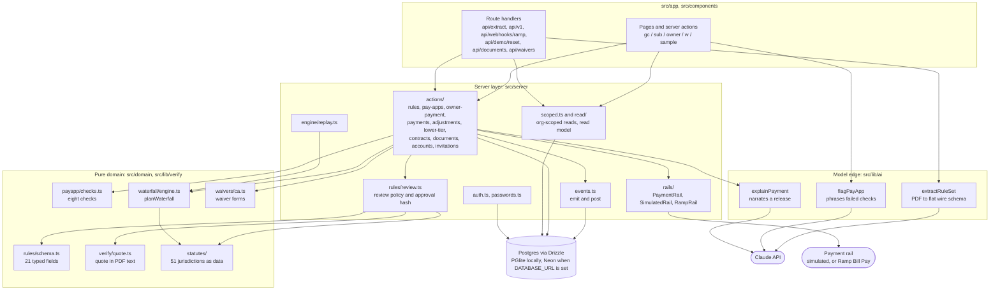
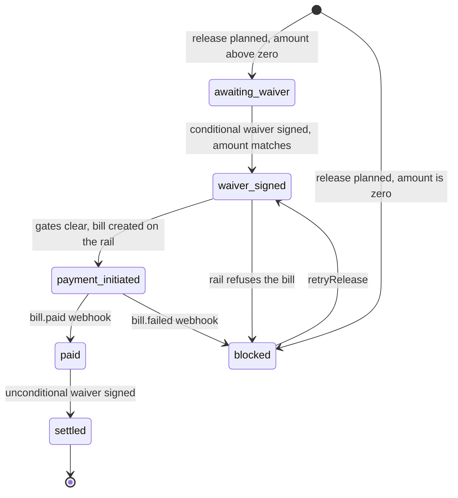
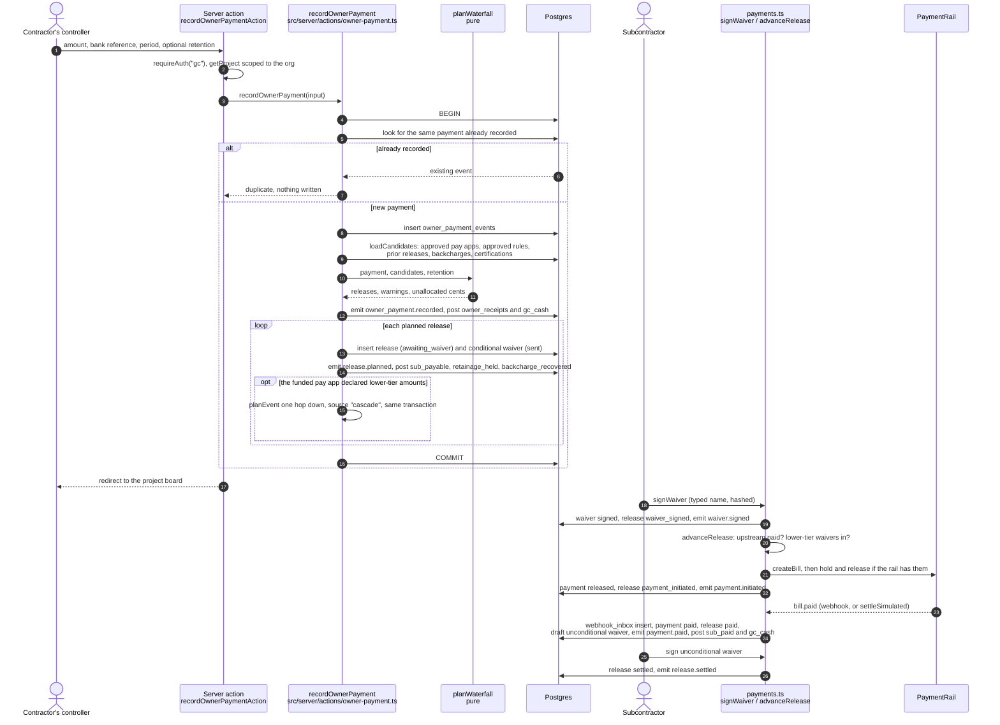
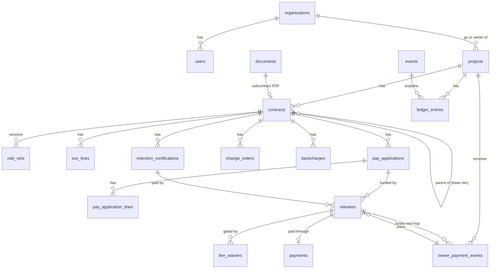

# Architecture

Groundwork is one Next.js 16 application (React 19, TypeScript) over Postgres. It reads a construction subcontract with Claude, turns it into payment rules a person approves, and from then on splits each owner payment between subcontractors with deterministic code.

This document describes the system as it is in the repository. The reasons behind each choice are in [docs/adr/](adr/README.md) and [DECISIONS.md](DECISIONS.md). Limits and things that are simulated are listed at the end.

## The shape in one paragraph

The model sits at the edges. It proposes a rule set from a PDF and it phrases explanations. Everything between those edges is ordinary code: quote verification, the statutory overlay, the review policy, the pay-application checks, the allocator, the ledger, waiver gating, and the payment rail adapter. A person approves the rules once. The engine reads only approved rule sets.

## Components

## Layers

### 1. Model edge (`src/lib/ai`)

Three functions call the Claude API, all through `messages.parse` with a Zod output format. The model id is set in one place, `src/lib/ai/client.ts`.

| Function | Input | Output | If there is no API key |
|---|---|---|---|
| `extractRuleSet` (`extractRuleSet.ts`) | The subcontract PDF as a document block | A flat list of 21 entries (path, found, value as text, quote, page, confidence, rationale) plus anomalies | `POST /api/extract/:contractId` replays the answer key for the three seeded contracts, and returns 409 for any other PDF |
| `flagPayApp` (`flagPayApp.ts`) | The non-passing results of the deterministic checks, in cents | A sentence and a recommendation per check | Returns `[]` |
| `explainPayment` (`explainPayment.ts`) | The engine's basis for one release: math lines, quoted clauses, statute ids | A short explanation and a next step | `deterministicExplanation` builds the same text from the same facts |

`fromWire` in `extractRuleSet.ts` parses each text value into its type and throws on anything that does not parse. `StrictRuleSetSchema` in `src/domain/rules/schema.ts` then applies range checks (days 0 to 120, retainage 0 to 20%, a two-letter state). The extraction prompt forbids applying law or inferring a value the contract does not state.

### 2. Verification and review (`src/lib/verify`, `src/server/rules/review.ts`)

`annotate` runs once when a rule set is created. For every field it:

1. Looks for the model's quote in the PDF's extracted text with `verifyQuote` (`src/lib/verify/quote.ts`). Both sides are normalized (NFKC, case, whitespace, quote and dash variants, line-break hyphenation). The result is `exact`, `fuzzy` (windowed Levenshtein similarity of at least 0.90), `unverified`, or `none`.
2. Computes the statutory overlay for the governing state with `overlayFor`.
3. Assigns a review state:
   - `auto_accepted`: high confidence, quote verified, no anomaly on the field.
   - `needs_review`: medium confidence, a fuzzy match under 0.95, an anomaly on the field, or a statute that limits the clause.
   - `escalated`: low confidence, quote not found, a value with no quote, a required field missing, pay-if-paid where it is void, or a retainage rate over the statutory cap.

`approveRuleSet` (`src/server/actions/rules.ts`) refuses while any field is `needs_review` or `escalated`, or any anomaly is unacknowledged. A reviewer resolves a field with `resolveField` (accept, or override with a value and a note). An override is checked against the same ranges as an extracted value (`overrideError` in `src/domain/rules/schema.ts`), so a reviewer cannot store a negative rate or a non-number as a rule. On approval the rule set is marked `approved`, stamped with `approvedHash` (SHA-256 of the effective values and the overlay), and the previous approved version becomes `superseded`. `resolveField` and `acknowledgeAnomaly` refuse to touch an approved or superseded rule set.

`effectiveValues` is the only way the rest of the system reads rules: extracted values with reviewer overrides applied.

### 3. Statutory overlay (`src/domain/statutes`)

`data/states.json` holds one record per jurisdiction (50 states and DC): prompt-payment deadline, retainage cap, retainage pass-through deadline, pay-if-paid status, and lien waiver form rules, each with a citation, a source URL and a confidence level. `index.ts` turns a record into a `StatutoryOverlay` for a given state, contract date and prime contract size. A rule the research could not confirm is `null`, and the engine falls back to the contract's terms and records a warning.

Conditions that needed a structured reading (business-day periods, caps that step down at 50% completion, caps that depend on the prime contract's size) are small tables in `index.ts` beside the data, so the researched record stays a copy of its sources.

### 4. Pay-application checks (`src/domain/payapp/checks.ts`)

`runPayAppChecks` is pure. It runs eight checks: `rules_approved`, `line_math`, `sov_overbilling`, `previously_billed`, `retainage_rate`, `net_due_math`, `period_sequence`, `contract_sum`. A failing `retainage_rate` check carries a `correction` so the reviewer can apply the contract rate in one step. `reviewPayApp` re-runs the checks at approval time and refuses to approve while any check fails, except a lone retainage failure when the correction is applied.

### 5. The allocator (`src/domain/waterfall/engine.ts`)

`planWaterfall(payment, candidates, retention)` is pure: no database, no clock, no randomness. Given one funding event and the approved pay applications it can fund, it returns planned releases, unfunded applications, unallocated cents and warnings.

- Allocation is on gross, pro-rata by remaining gross, with largest-remainder rounding (`allocateProRata`), so the parts always sum to the payment.
- Retainage is the contract rate, clamped to the statutory cap where one applies, and limited by the contract's own cap.
- Backcharges are set off per contract and never push a release below zero; what one release cannot absorb carries to the contract's next release.
- A final application withholds no new retainage and pays out what is held only when the payment includes retention.
- Certified retainage (`RetentionCandidate`) is released when the payer receives retention.
- Each release gets a pay-by deadline from the contract's period and the governing state's prompt-payment rule, and a `basis`: the rule paths, statute ids, math lines and notes that produced its numbers.

Money is integer cents. Percentages are basis points.

### 6. Ledger and events (`src/server/events.ts`)

`emit` inserts a row into `events` (the audit trail). `post` inserts rows into `ledger_entries`. Both are called inside the caller's transaction. A balance is the sum of `delta_cents` for an account. The ledger accounts are `owner_receipts`, `gc_cash`, `sub_payable`, `retainage_held`, `sub_paid`, `backcharge_recovered`, `lower_tier_payable` and `lower_tier_paid`.

`src/server/engine/replay.ts` re-runs `planWaterfall` over every funding event of a project, reconstructing the inputs as they stood when each event was recorded, and reports any difference from the stored releases.

Append-only is a code convention, not a database constraint. There are no triggers. The exceptions that exist in code are listed under [Known limits](#known-limits).

### 7. Waiver gating and the payment rail (`src/server/actions/payments.ts`, `src/server/rails`)

A release moves through these states:

`advanceRelease` sends a release to the rail only when:

1. its conditional waiver is signed and the waiver amount equals the release amount,
2. for a lower-tier release, the upstream release that funds it is `paid` or `settled`, and
3. if the approved rules require lower-tier waivers, every lower-tier release it funds has cleared its own waiver.

`PaymentRail` (`src/server/rails/types.ts`) is the adapter: `createBill`, optional `hold` and `release`, `attach`, `getStatus`, `parseWebhook`. `getRail()` returns `RampRail` only when `PAYMENT_RAIL=ramp` and `RAMP_CLIENT_ID` is set; otherwise `SimulatedRail`. There is one `payments` row per release; a failed attempt is reused on retry.

Settlement arrives through `handleRailWebhook`: the event is inserted into `webhook_inbox` first (unique on rail and external event id, so a duplicate delivery is a no-op), then the payment and release are marked paid, the unconditional waiver is drafted, and the ledger is posted. For the simulated rail, `settleSimulated` builds a synthetic `bill.paid` event and calls the same function.

### 8. Read side and authorization (`src/server/scoped.ts`, `src/server/read`)

Every query that returns business data goes through org-scoped helpers. A general contractor sees its projects and contracts, a subcontractor sees only contracts where it is the payee, an owner sees projects it owns. `src/server/read/project.ts` builds the read model (summary, money flow graph, timeline, balance series, clocks) that both the pages and `GET /api/v1/...` serve.

Sessions are an HS256 JWT in the `gw_session` cookie (`src/server/auth.ts`). Real accounts sign in with a password hashed with scrypt (`src/server/passwords.ts`). The sample workspace is entered by picking a seeded person at `/sample`. Lower-tier claimants have no account and are authorized by an unguessable token in the URL (`/w/:token`).

## Request and data flow

### Compile a subcontract

1. The contractor uploads a PDF. `addSubcontract` (`src/server/actions/contracts.ts`) validates it with `inspectPdf` (must be a PDF of at most 4 MB with a text layer), stores the bytes and per-page text in `documents`, and creates a draft contract.
2. The review page calls `POST /api/extract/:contractId`. The route checks the session is a general contractor that can see the contract, and rejects a PDF with no text layer (422).
3. With an API key, `extractRuleSet` sends the PDF to Claude and parses the result. One read per contract runs at a time in a server process; a second request waits for the first.
4. `createRuleSet` runs `annotate` (quote verification, overlay, review states), inserts the rule set as the next version, sets the contract to `in_review`, and emits `rules.extracted`.
5. The reviewer resolves flagged fields (`rules.field_accepted`, `rules.field_overridden`) and acknowledges anomalies (`rules.anomaly_acknowledged`).
6. `approveRuleSet` freezes the version with its hash, sets `contracts.active_rule_set_id` and status `active`, and emits `rules.approved`.

### Review a pay application

1. The subcontractor submits the form. `submitPayApp` (`src/server/actions/pay-apps.ts`) computes line history from prior approved applications, runs `runPayAppChecks`, stores the application and its check results, and emits `pay_app.submitted`.
2. The page action then calls `flagPayApp` as a best-effort step. If it returns notes they are stored on the application; a failure is logged and ignored.
3. The contractor approves, approves with the retainage correction, or requests changes. `reviewPayApp` re-runs the checks, stores the approved retainage and net due, emits `pay_app.approved` or `pay_app.changes_requested`, and creates any lower-tier applications the subcontractor declared.

### Record an owner payment

Recording the same owner payment twice returns the first event and writes nothing. A payment is the same when it carries the same idempotency key or, when the caller supplies no key, the same project, bank reference and amount. The receipt time is not part of the identity, because the form defaults it to the current time.

## Data model

All tables are defined in `src/db/schema.ts`; migrations are in `drizzle/`. Money columns are `bigint` cents read as numbers.

| Table | What it holds |
|---|---|
| `organizations`, `users`, `invitations` | Parties. An organization is an `owner`, `gc` or `sub`. `is_demo` marks the sample workspace. An invitation token works once and expires after 14 days. |
| `projects` | A job, its contractor, its owner, its state and prime contract sum. |
| `documents` | Uploaded PDFs: bytes (base64), SHA-256, per-page text. |
| `contracts` | A subcontract. `parent_contract_id` makes it a lower-tier agreement one hop down. `active_rule_set_id` is set only on approval. |
| `rule_sets` | Versioned rules as JSON: extracted fields, per-field verification and review, overlay, anomaly acknowledgements. `approved_hash` on approval. |
| `sov_lines`, `pay_applications`, `pay_application_lines` | Schedule of values and G702/G703-shaped billing, with stored check results. |
| `change_orders`, `backcharges`, `retention_certifications` | Recorded human decisions after the rules are approved. |
| `owner_payment_events` | Funding events: an owner payment, or (with `payer_contract_id` and `parent_release_id`) a lower-tier hop. Unique `idempotency_key`. |
| `releases` | One planned payment per funding event and pay application (or certification), with amounts, deadlines, status and `basis`. |
| `lien_waivers` | Conditional and unconditional waivers per release, with fields, signer, signature hash and optional `sign_token`. |
| `payments` | One row per release on a rail. |
| `events` | Domain events and audit trail. |
| `ledger_entries` | Postings per account; balances are sums. |
| `webhook_inbox` | Rail deliveries, unique on rail and external event id. |

## Trust boundary

| The model may | The model may not |
|---|---|
| Propose a value for each of the 21 fields, with a verbatim quote, page and confidence | Have a value accepted without code finding its quote in the PDF, or without a person resolving it |
| Report anomalies for a reviewer | Decide whether a clause is enforceable. The prompt says "Do not apply law"; statutes are applied by `src/domain/statutes` |
| Phrase the results of failed pay-app checks | Compute or change any amount. Check results and corrections come from `checks.ts` |
| Narrate a release from supplied facts | Approve rules, approve a pay application, plan a release, sign a waiver, or call the rail |

What enforces it:

- `planWaterfall`, `runPayAppChecks` and `overlayFor` import nothing from `src/lib/ai`.
- `loadCandidates` reads only contracts with status `active` and their `active_rule_set_id`, which only `approveRuleSet` sets (and `addLowerTierParty` for terms a person typed in).
- Output from `flagPayApp` and `explainPayment` is stored as display text (`pay_applications.flags`, a `release.explained` event). No code path reads it back into a calculation.
- If the model is unavailable, compiling fails with a 502 and pay-app notes are skipped. Recording payments, signing waivers and settlement do not call it.

What the boundary does not cover: a confident, correctly quoted misreading of a real clause passes quote verification. The review policy and the person approving are the remaining checks. The eval measures how often this happens (see [TESTING.md](TESTING.md)).

## Module map

| Path | Contents |
|---|---|
| `src/domain/rules/` | `schema.ts` (the 21 fields, evidence, review types), `from-spec.ts` (rule set from an answer key), `manual.ts` (rule set typed in for a lower-tier agreement), `format.ts` |
| `src/domain/statutes/` | `data/states.json`, `index.ts` (`overlayFor`, `STATE_LAW`, `STATUTES`, `coverage`) |
| `src/domain/payapp/checks.ts` | `runPayAppChecks` |
| `src/domain/waterfall/engine.ts` | `planWaterfall`, `allocateProRata`, `addBusinessDays` |
| `src/domain/waivers/ca.ts` | Waiver form ids, fields, body text, `unconditionalCounterpart` |
| `src/lib/ai/` | `client.ts`, `extractRuleSet.ts`, `flagPayApp.ts`, `explainPayment.ts` |
| `src/lib/verify/quote.ts` | `verifyQuote`, `normalizeForMatch` |
| `src/lib/pdf/` | `text.ts` (per-page text via unpdf), `contract-doc.tsx` and `waiver-doc.tsx` (PDF rendering) |
| `src/lib/` | `money.ts`, `ids.ts` (`stableId`, `sha256Hex`), `motion.ts` |
| `src/db/` | `schema.ts`, `client.ts` (`getDb`), `migrate.ts`, `seed.ts` (`seedBaseline`, `deleteSampleData`) |
| `src/server/actions/` | `rules.ts`, `pay-apps.ts`, `owner-payment.ts`, `payments.ts`, `adjustments.ts`, `lower-tier.ts`, `contracts.ts`, `documents.ts`, `projects.ts`, `accounts.ts`, `invitations.ts`, `explain.ts` |
| `src/server/rules/review.ts` | `annotate`, `blockingFields`, `effectiveValues`, `approvedHash` |
| `src/server/engine/replay.ts` | `replayProject` |
| `src/server/rails/` | `types.ts`, `index.ts` (`getRail`), `simulated.ts`, `ramp.ts` |
| `src/server/read/` | `project.ts`, `gc-lists.ts`, `gc-money.ts`, `sub.ts`, `eval.ts`, `api.ts` |
| `src/server/` | `auth.ts`, `passwords.ts`, `scoped.ts`, `events.ts`, `clock.ts`, `demo/reset.ts` |
| `src/app/` | `gc/`, `sub/`, `owner/`, `w/[token]/`, `sample/`, `sign-in/`, `sign-up/`, `invite/[token]/`, `statutes/`, `api/` |
| `src/app/api/` | `extract/[contractId]`, `v1/` (read API), `webhooks/ramp`, `demo/reset`, `documents/[id]`, `waivers/[id]/pdf` |
| `src/components/` | Feature components, `ui/` primitives, `viz/` charts, `tour/`, `landing/` |
| `drizzle/` | SQL migrations and snapshots |
| `seed/` | Sample contracts (markdown and rendered PDF), answer keys, the Texas contract and its cached extraction |
| `evals/` | Harness (`run.ts`, `score.ts`), specs, generated contracts, cached extractions, results |
| `scripts/` | Reset, contract rendering and generation, Ramp webhook registration, browser-driven dev tools |

## Known limits

- **Append-only has exceptions.** `handleRailWebhook` updates `received_at` on a lower-tier `owner_payment_events` row once the upstream payment actually settles. `webhook_inbox` rows get `processed_at` and `error` set after insert. A demo reset deletes the sample workspace's events and ledger entries. `releases`, `payments`, `lien_waivers`, `pay_applications` and unapproved `rule_sets` are mutable state by design; their history is in `events`.
- **Rail calls are outside the database transaction.** `initiatePayment` creates the payment row, calls the rail, then records the result. A crash between the rail call and the final update leaves a payment in `created` or `held`; there is no reconciliation job.
- **The Ramp adapter has not been run against a sandbox.** Its request shapes follow Ramp's documentation and its signature check is unit-tested.
- **The in-process extraction lock is per server process.** Two processes can read the same contract at once.
- **Business days skip weekends only.** Holidays are not modelled.
- **Allocation is on gross.** The owner's own retainage against the contractor is not modelled.
- **Lower-tier agreements** are typed in rather than compiled, and cannot carry retainage.
- **Waiver forms**: only California's statutory text is reproduced. Other states get a general form that says when the state prescribes its own.
- **User roles** (`admin`, `ap`, `pm`, `viewer`) are stored and displayed. Authorization is by organization and contract scope, not by role.
